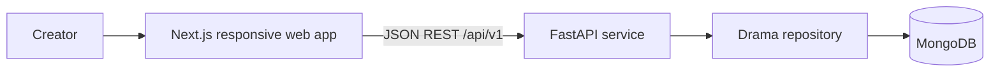

# High-Level Design

## System context

## Components
- **Frontend:** Next.js App Router, TypeScript, Tailwind, Radix Dialog primitives, and TanStack Query. Query hooks own server reads; mutation hooks own writes and invalidate cached lists/details. Components keep form and filter state local.
- **Backend:** FastAPI routers map HTTP requests to a service layer. Pydantic schemas validate requests, a repository interface isolates persistence, and a PyMongo repository stores drama documents with embedded scenes.
- **Media:** cover images and direct video preview URLs are supported; video upload and transcoding are outside the MVP.

## Data flow
1. TanStack Query runs a typed API request for a drama list or detail.
2. Create, update, and delete mutations send JSON to `/api/v1/dramas`.
3. FastAPI validates payloads and the service enforces story rules, including the ready-state runtime limit.
4. The repository reads or writes MongoDB; successful mutations invalidate affected query keys.

## Deployment shape
Deploy Next.js and FastAPI separately. Configure `NEXT_PUBLIC_API_URL` and backend `CORS_ORIGINS`. A production deployment should use a managed MongoDB cluster, object storage for uploaded media, authentication, observability, and backups.

## Key decisions
- Separate frontend and backend folders for independent development/deployment.
- Episode/scene structure captures the one-minute storytelling constraint explicitly.
- A 60-second cap is a product rule, not an infrastructure limit; scripts can be saved over target with a visible warning during drafting.
