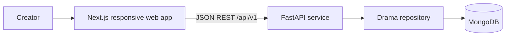

# High-Level Design

## System context

## Components
- **Frontend:** Next.js App Router, React, TypeScript, Tailwind, shadcn-style primitives. Dashboard and editor are client-interactive. A typed API client isolates transport from views.
- **Backend:** FastAPI routers, Pydantic schemas, service layer, repository interface. MongoDB stores drama documents with embedded scene arrays.
- **Media:** cover images and direct video preview URLs are supported; video upload and transcoding are outside the MVP.

## Data flow
1. UI calls the typed API client for list/detail/create/update operations.
2. Client sends JSON to `/api/v1/dramas`.
3. Router validates via Pydantic and delegates to the service.
4. Repository stores/returns domain records; API returns JSON and HTTP status.

## Deployment shape
Deploy Next.js and FastAPI separately. Configure `NEXT_PUBLIC_API_URL` and backend `CORS_ORIGINS`. A production deployment should use a managed MongoDB cluster, object storage for uploaded media, authentication, observability, and backups.

## Key decisions
- Separate frontend and backend folders for independent development/deployment.
- Episode/scene structure captures the one-minute storytelling constraint explicitly.
- A 60-second cap is a product rule, not an infrastructure limit; scripts can be saved over target with a visible warning during drafting.
